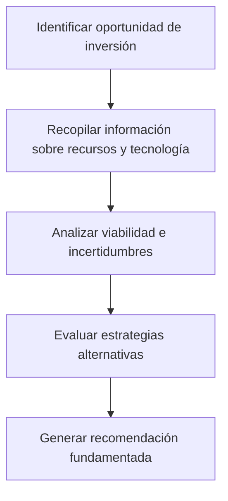
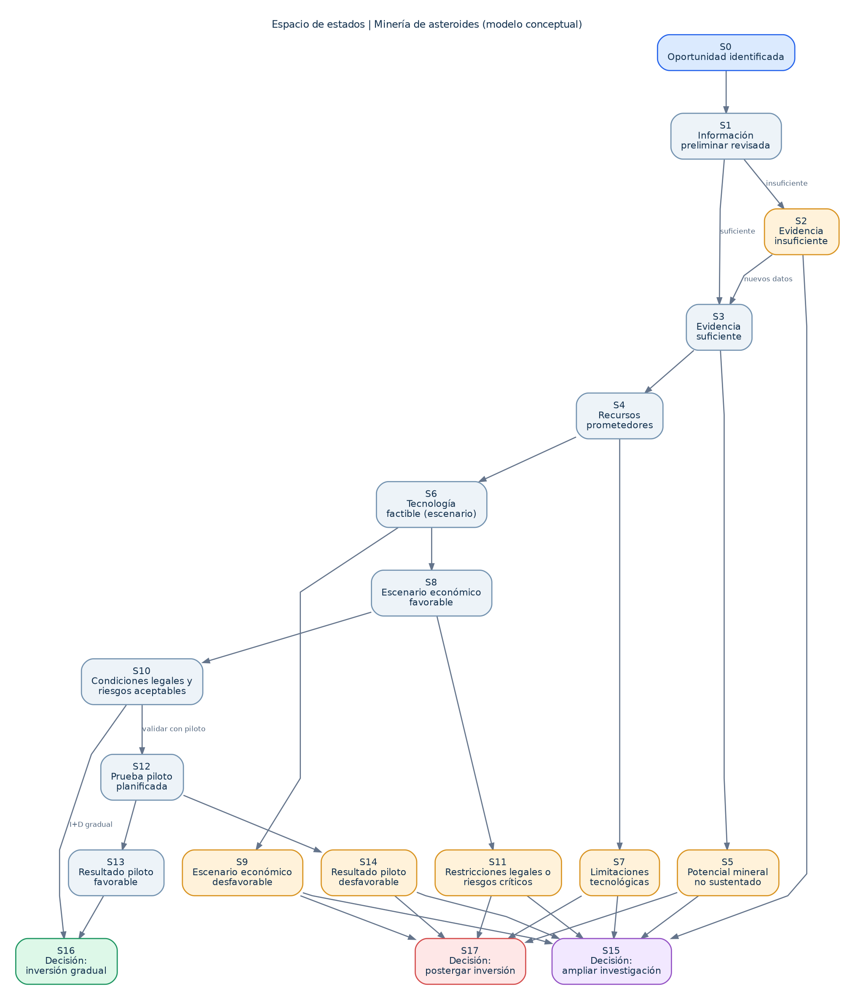
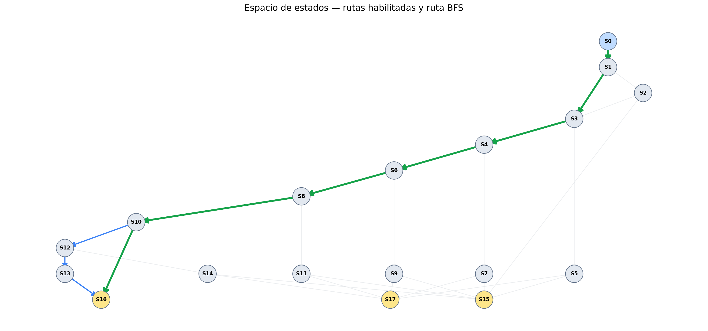
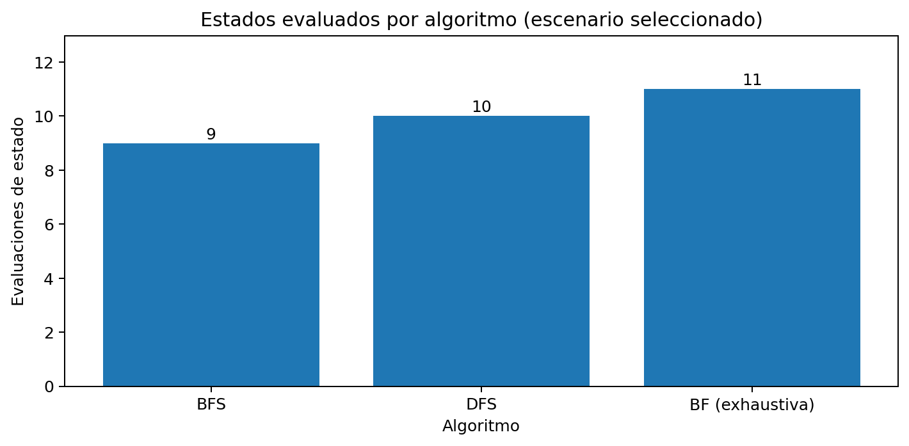
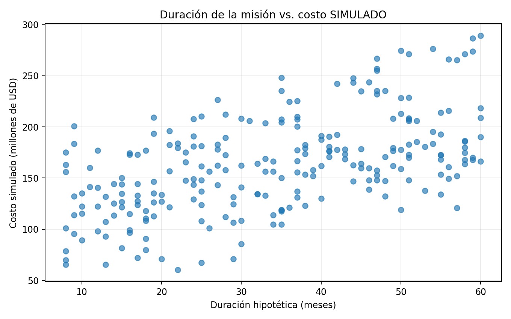
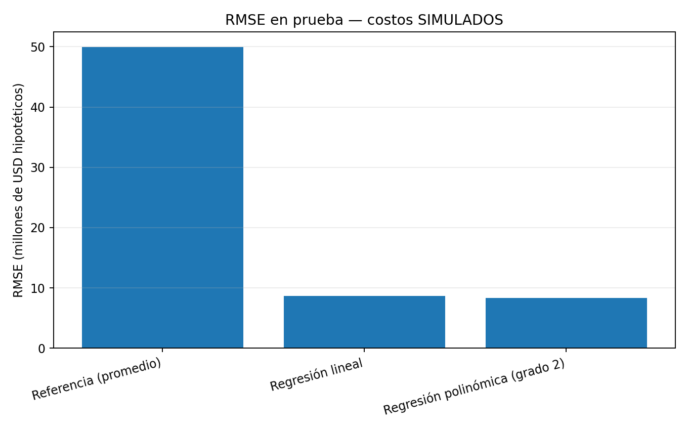
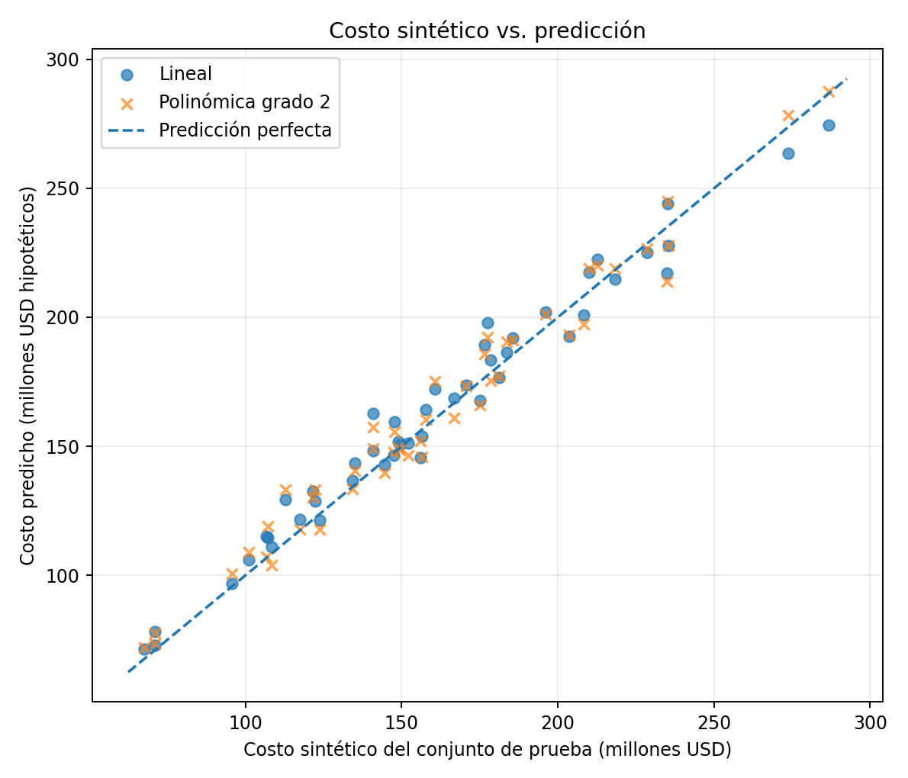
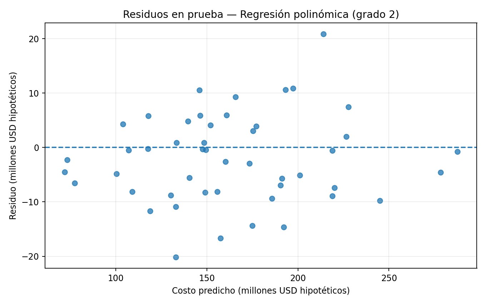
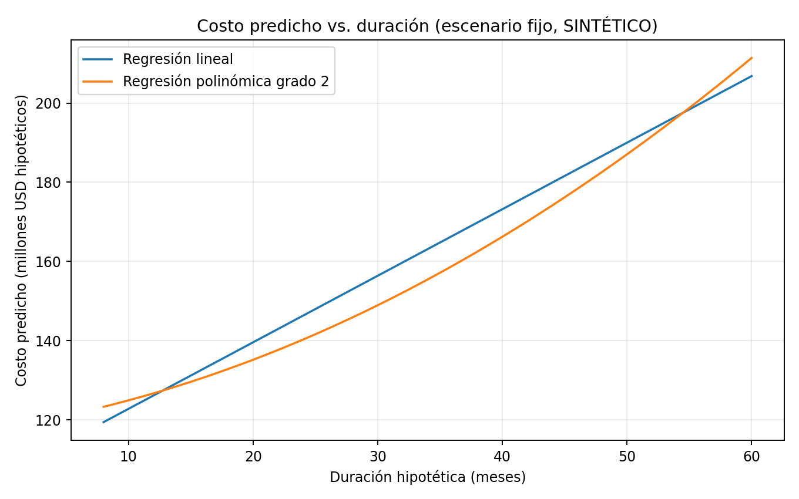

<!-- README: presentación editorial inspirada en el lenguaje visual de SpaceX, Linear y Vercel. -->

  
  
<strong>UNIVERSIDAD PERUANA CAYETANO HEREDIA</strong> &nbsp; / &nbsp; CIENCIAS E INGENIERÍA

<table>
<tr>
<td width="70%" valign="middle">
  <h1>Challenge 2: Pipeline de Machine Learning</h1>
  <h2>Minería de asteroides: evaluación experimental de estrategias de inversión</h2>
  
<strong>Machine Learning</strong> &nbsp;·&nbsp; Challenge individual

  

    
  

  
<a href="https://pao25-ing.github.io/Machine_Learning/Challenge_2/web/">Inicio</a> &nbsp;·&nbsp; <a href="https://pao25-ing.github.io/Machine_Learning/Challenge_2/web/analisis-de-decisiones.html">Análisis de decisiones</a> &nbsp;·&nbsp; <a href="https://pao25-ing.github.io/Machine_Learning/Challenge_2/web/visualizacion-predictiva.html">Visualización predictiva</a>

</td>
<td width="30%" valign="middle" align="center">
  
</td>
</tr>
</table>

  
  
  
  

 

<table align="center">
<tr>
<td width="25%" align="center"><strong>18</strong> ESTADOS</td>
<td width="25%" align="center"><strong>28</strong> TRANSICIONES</td>
<td width="25%" align="center"><strong>6</strong> ESCENARIOS</td>
<td width="25%" align="center"><strong>240</strong> REGISTROS SINTÉTICOS</td>
</tr>
</table>

## Información académica

| **Campo** | **Detalle** |
|:--|:--|
| **Curso** | Machine Learning |
| **Universidad** | Universidad Peruana Cayetano Heredia (UPCH) |
| **Facultad** | Ciencias e Ingeniería |
| **Docente** | Yannick Patrick Carrasco Merma |
| **Modalidad** | Challenge individual |

> **Alcance académico:** los estados, decisiones y escenarios de búsqueda son parte de un modelo conceptual experimental. Los 240 registros de costos empleados en la regresión son **sintéticos**. Las predicciones y recomendaciones no demuestran la viabilidad de la minería comercial de asteroides ni constituyen asesoría de inversión.

## Acceso rápido

<table>
<tr>
<td align="center" width="50%">
  <strong><a href="https://pao25-ing.github.io/Machine_Learning/Challenge_2/web/analisis-de-decisiones.html">ANÁLISIS DE DECISIONES</a></strong>
   BFS &nbsp;·&nbsp; DFS &nbsp;·&nbsp; BF
   
</td>
<td align="center" width="50%">
  <strong><a href="https://pao25-ing.github.io/Machine_Learning/Challenge_2/web/visualizacion-predictiva.html">VISUALIZACIÓN PREDICTIVA</a></strong>
   Regresión lineal &nbsp;·&nbsp; Polinómica de grado 2
   
</td>
</tr>
</table>

<strong>EXPLORAR CONTENIDO DEL ESTUDIO</strong>

| Fundamentos | Métodos | Resultados |
|:--|:--|:--|
| [01 — Presentación](#presentacion) | [04 — Espacio de estados](#estados) | [07 — Discusión y conclusiones](#conclusiones) |
| [02 — Contexto](#contexto) | [05 — Razonamiento y búsqueda](#busqueda) | [08 — Ejecución y tecnologías](#ejecucion) |
| [03 — Representación](#representacion) | [06 — Predicción y visualización](#prediccion) | [09 — Referencias IEEE](#referencias) |

---

## 1. Presentación del caso y problema

La minería de asteroides plantea la posibilidad de aprovechar minerales y materias primas presentes en cuerpos celestes, entre ellos níquel, cobalto y metales del grupo del platino. La infografía proporcionada para el examen parcial presenta oportunidades de crecimiento asociadas con tecnologías espaciales, robótica y automatización, pero también importantes incertidumbres.

Las proyecciones comerciales del mercado muestran interés por el sector, aunque no prueban su viabilidad extractiva [1]. La NASA distingue la **exploración científica de asteroides** de una operación de minería comercial: las tecnologías de extracción siguen planteando desafíos significativos [2]. Por ello, es necesario analizar la información disponible antes de formular estrategias de inversión.

**Problema:** la incertidumbre tecnológica, económica y regulatoria dificulta seleccionar estrategias de exploración e inversión en minería de asteroides que puedan justificarse con la evidencia disponible.

**Pregunta guía:** ¿Cómo explorar rutas válidas de evaluación de inversiones y estimar costos de misiones hipotéticas mediante las técnicas de Inteligencia Artificial y Machine Learning estudiadas en clase?

### 1.1. Objetivo general

Desarrollar dos pipelines experimentales que permitan **explorar estrategias de inversión** a través de un espacio de estados y **estimar costos sintéticos** mediante modelos de regresión, documentando los supuestos, resultados y limitaciones.

### 1.2. Objetivos específicos

1. Representar el problema mediante estados, operadores, transiciones y restricciones.
2. Aplicar y comparar BFS, DFS y búsqueda exhaustiva (*Brute Force*, BF).
3. Preparar un dataset sintético y reproducible para una tarea de regresión supervisada.
4. Entrenar y comparar regresión lineal y regresión no lineal polinómica de grado 2.
5. Comunicar los resultados mediante Google Colab, GitHub y una web responsive.

<a href="#top">Volver al inicio</a>

---

## 2. Contexto e investigación documental

  
   <em>Figura 1. Recreación visual con IA de la infografía del examen parcial, conservando la información de la infografía original proporcionada para el caso.</em>

### 2.1. Mercado y recursos de interés

De acuerdo con el informe de *The Business Research Company*, el tamaño **estimado** del mercado de minería de asteroides para 2026 es de **USD 2,49 mil millones** y su valor **proyectado** para 2030 es de **USD 5,42 mil millones**, con una tasa de crecimiento anual compuesta (CAGR) del **21,4 %** entre 2026 y 2030 [1]. Estas cantidades describen estimaciones comerciales de mercado; **no representan ingresos comprobados de extracción de minerales desde asteroides**.

El caso identifica recursos de interés como níquel, cobalto, metales del grupo del platino y tierras raras, vinculados con aplicaciones tecnológicas e industriales.

### 2.2. Tecnologías y antecedentes

La infografía señala robótica espacial, sistemas autónomos, detección de materiales, extracción robótica y optimización de misiones como áreas tecnológicas relevantes. Entre los antecedentes documentados se encuentran:

- **Robot SCAR-E:** ispace y Asteroid Mining Corporation anunciaron en 2024 un acuerdo para estudiar una futura demostración de este robot sobre la superficie lunar. El anuncio se refiere a una colaboración prevista, no a una extracción minera comercial realizada [3].
- **Misión Psyche:** la NASA desarrolla una misión científica para estudiar un asteroide rico en metales; su finalidad es obtener conocimiento sobre el cuerpo celeste, no ejecutar minería comercial [4].
- **Misión OSIRIS-REx:** la NASA recuperó y entregó a la Tierra muestras del asteroide Bennu en 2023; es un antecedente de recolección científica de muestras y no de explotación comercial [5].

### 2.3. Incertidumbres y restricciones

El material del examen menciona información no reportada o insuficiente sobre costos reales de extracción, rentabilidad, concentración de minerales, retorno de la inversión, probabilidad de éxito técnico, aspectos regulatorios e impacto ambiental y geopolítico.

Como parte del contexto jurídico, el Tratado del Espacio Ultraterrestre establece límites a la apropiación nacional de los cuerpos celestes. Su existencia justifica considerar la dimensión regulatoria en la evaluación, sin asumir que resuelve por sí sola todas las cuestiones legales de la extracción espacial [6].

| Dimensión | Información relevante | Tratamiento en el proyecto |
|---|---|---|
| Recursos | Minerales potencialmente aprovechables | Evaluación cualitativa de evidencia |
| Tecnología | Exploración, robótica y automatización | Condiciones del espacio de estados |
| Economía | Proyecciones de mercado, costos inciertos | Escenarios experimentales y regresión sintética |
| Regulación | Marco jurídico y posibles restricciones | Reglas de transición |
| Riesgos | Fallas técnicas y resultados desconocidos | Rutas alternativas y decisiones pendientes |

<a href="#top">Volver al inicio</a>

---

## 3. Representación conceptual

Antes de construir el espacio de estados, se simplificó el problema mediante un flujo general de evaluación. Esta **representación conceptual** no equivale al grafo de estados utilizado por los algoritmos de búsqueda.

<em>Figura 2. Representación conceptual del proceso de evaluación. Elaboración propia.</em>

<a href="#top">Volver al inicio</a>

---

## 4. Espacio de estados

Se construyó un grafo experimental de **18 estados (S0–S17)** y **28 transiciones**. El agente inicia en **S0: Oportunidad identificada**. Los estados y las acciones se formularon siguiendo los conceptos de representación y búsqueda estudiados en el curso.

  
   <em>Figura 3. Espacio de estados para la evaluación de estrategias de inversión. Elaboración propia.</em>

### 4.1. Estados terminales y objetivo de búsqueda

| Estado | Decisión modelada |
|---|---|
| **S15** | Ampliar investigación |
| **S16** | Inversión gradual en **investigación y desarrollo (I+D)** |
| **S17** | Postergar inversión |

Estos son **tres resultados terminales posibles**, no tres objetivos igualmente deseables. El **objetivo general** consiste en obtener una recomendación fundamentada según el escenario. Para comparar **BFS y DFS** se elige un estado terminal como objetivo específico (S16 en el escenario favorable); **BF** enumera las rutas habilitadas hasta los diferentes estados terminales.

### 4.2. Operadores y restricciones

Los operadores modelan acciones como recopilar evidencia, evaluar recursos minerales, verificar factibilidad tecnológica, revisar el escenario económico y regulatorio, plantear una prueba piloto y emitir una decisión. Las transiciones se habilitan mediante reglas **SI–ENTONCES**.

Las restricciones impiden avanzar cuando faltan evidencias, cuando la tecnología no cumple las condiciones experimentales o cuando existen barreras económicas o regulatorias críticas. Un valor desconocido **no debe convertirse automáticamente en favorable**.

**Archivos del modelo:** [espacio_estados_condiciones.json](./data/espacio_estados_condiciones.json) y [escenarios_asteroides.json](./data/escenarios_asteroides.json).

<a href="#top">Volver al inicio</a>

---

## 5. Pipeline 1: razonamiento, búsqueda y resultados

Este pipeline emplea principalmente **razonamiento deductivo**: a partir de reglas y de las condiciones de un escenario se determinan las transiciones permitidas. Se implementaron los algoritmos revisados en las sesiones de búsqueda en profundidad, búsqueda en anchura y búsqueda exhaustiva.

| Algoritmo | Estrategia |
|---|---|
| **BFS** | Explora por niveles y encuentra una ruta con el menor número de transiciones en un grafo no ponderado. |
| **DFS** | Explora una rama en profundidad antes de retroceder. |
| **BF (Brute Force)** | Enumera exhaustivamente las rutas simples habilitadas hasta los estados terminales del modelo finito. |

**Notebook:** [01_Pipeline_Razonamiento_Busqueda_Resultados.ipynb](./notebooks/01_Pipeline_Razonamiento_Busqueda_Resultados.ipynb)  
**Google Colab:** [Abrir Pipeline 1](https://colab.research.google.com/github/pao25-ing/Machine_Learning/blob/main/Challenge_2/notebooks/01_Pipeline_Razonamiento_Busqueda_Resultados.ipynb)

### 5.1. Resultados del escenario favorable

**Estado inicial:** S0. **Objetivo:** S16 (inversión gradual en I+D).

| Algoritmo | Evaluaciones registradas | Resultado |
|---|---:|---|
| BFS | 9 | Ruta de 7 transiciones |
| DFS | 10 | Ruta de 9 transiciones |
| BF | 11 | 2 rutas completas enumeradas |

**BFS:** `S0 → S1 → S3 → S4 → S6 → S8 → S10 → S16`  
**DFS:** `S0 → S1 → S3 → S4 → S6 → S8 → S10 → S12 → S13 → S16`

El conteo de BF incluye evaluaciones dentro de rutas enumeradas y puede repetir estados compartidos; no es directamente comparable con el conteo de BFS y DFS. BFS encontró una ruta más corta **en transiciones**, no necesariamente una inversión de menor costo.

  
   <em>Figura 4. Transiciones habilitadas en el escenario experimental.</em>

  
   <em>Figura 5. Comparación de la exploración de los algoritmos.</em>

También se probaron seis escenarios: condiciones favorables, información insuficiente, limitaciones técnicas, economía desfavorable, piloto desfavorable y datos incompletos. Este último concluye sin una decisión cuando falta información esencial.

**Resultados:** [comparacion_busqueda.csv](./results/comparacion_busqueda.csv) y [escenarios_busqueda.csv](./results/escenarios_busqueda.csv).

<a href="#top">Volver al inicio</a>

---

## 6. Pipeline 2: predicción y visualización

**Tipo de aprendizaje:** supervisado.  
**Tarea:** regresión para estimar un valor continuo.  
**Pregunta:** ¿Cómo se relaciona el costo hipotético de una misión de exploración con su duración, masa del equipo, complejidad tecnológica y grado de autonomía?

La selección de regresión lineal y no lineal polinómica de grado 2 se basa en los métodos trabajados en el laboratorio de la sesión 7.

### 6.1. Dataset sintético

Se generaron **240 escenarios totalmente sintéticos** mediante una fórmula educativa que incorpora efectos lineales, cuadráticos y ruido aleatorio. El dataset **no contiene costos observados de misiones reales**.

| Variable | Función |
|---|---|
| `duracion_meses` | Entrada: duración hipotética |
| `masa_equipo_kg` | Entrada: masa del equipo |
| `complejidad_tecnica` | Entrada: nivel experimental de 1 a 5 |
| `autonomia_pct` | Entrada: porcentaje hipotético de autonomía |
| `costo_simulado_musd` | **Salida:** costo simulado en millones de USD |

Se utilizaron **192 observaciones para entrenamiento (80 %)** y **48 para prueba (20 %)**. Se compararon un modelo de referencia basado en el promedio, una regresión lineal y una regresión polinómica de grado 2.

**Dataset:** [escenarios_costos_SINTETICOS.csv](./data/escenarios_costos_SINTETICOS.csv)  
**Notebook:** [02_Pipeline_Prediccion_Visualizacion.ipynb](./notebooks/02_Pipeline_Prediccion_Visualizacion.ipynb)  
**Google Colab:** [Abrir Pipeline 2](https://colab.research.google.com/github/pao25-ing/Machine_Learning/blob/main/Challenge_2/notebooks/02_Pipeline_Prediccion_Visualizacion.ipynb)

### 6.2. Resultados de regresión

| Modelo | MAE ↓ | RMSE ↓ | R² ↑ |
|---|---:|---:|---:|
| Referencia (promedio) | 40,10 | 49,93 | -0,0032 |
| Regresión lineal | 7,06 | 8,64 | 0,9700 |
| **Regresión polinómica (grado 2)** | **6,72** | **8,33** | **0,9721** |

*MAE y RMSE expresados en millones de USD hipotéticos; métricas calculadas sobre los 48 registros sintéticos de prueba.*

La regresión polinómica tuvo un error ligeramente inferior y explicó cerca del **97,21 %** de la variación en el costo sintético del conjunto de prueba. Este resultado es coherente con los términos cuadráticos del generador y **no acredita capacidad predictiva sobre costos reales de misiones espaciales**.

  
   <em>Figura 6. Dispersión de datos sintéticos.</em>

  
   <em>Figura 7. Comparación del RMSE de los modelos.</em>

  
   <em>Figura 8. Valores sintéticos frente a predicciones.</em>

  
   <em>Figura 9. Distribución de residuos del modelo polinómico.</em>

  
   <em>Figura 10. Regresión lineal y polinómica para una variación de duración con otras entradas constantes.</em>

**Resultados:** [comparacion_regresion.csv](./results/comparacion_regresion.csv) y [predicciones_prueba.csv](./results/predicciones_prueba.csv).

<a href="#top">Volver al inicio</a>

---

## 7. Discusión y conclusiones

El **Pipeline 1** permitió representar y recorrer rutas alternativas con BFS, DFS y BF, respetando condiciones definidas para seis escenarios. El **Pipeline 2** permitió aplicar técnicas de aprendizaje supervisado y comparar modelos de regresión sobre datos generados de manera reproducible.

La regresión polinómica mostró una mejora pequeña frente a la lineal en el experimento sintético. Por otro lado, BFS halló una ruta de menos transiciones que DFS en el escenario favorable. **Ninguno de los dos resultados, por sí solo, demuestra rentabilidad comercial.**

Los pipelines **no integran automáticamente predicción y decisión financiera**: la estimación sintética de costos no define por sí sola la rentabilidad ni el estado económico real. Se necesitarían datos observados, escenarios de ingresos, costos de financiación, riesgos técnicos y restricciones normativas verificadas.

<a href="#top">Volver al inicio</a>

---

## 8. Ejecución y tecnologías

1. Abrir cualquiera de los dos notebooks desde el enlace correspondiente de Google Colab.
2. Seleccionar **Entorno de ejecución → Ejecutar todas**.
3. Revisar las tablas, los gráficos y las conclusiones generadas.

Se utilizan Python, `numpy`, `pandas`, `matplotlib`, `networkx` y `scikit-learn`. Los archivos JSON permitirán reutilizar el espacio de estados y los escenarios en la web. Esta organización responde a los cuatro apartados solicitados por la rúbrica del challenge.

<a href="#top">Volver al inicio</a>

---

## 9. Referencias (formato IEEE)

[1] The Business Research Company, “Asteroid Mining Market Report 2026,” sep. 2026. [En línea]. Disponible en: https://www.thebusinessresearchcompany.com/report/asteroid-mining-global-market-report. [Accedido: 14-oct-2026].

[2] E. Furfaro, “Is NASA Mining Asteroids? We Asked a NASA Scientist: Episode 41,” NASA, 28-jun-2023. [En línea]. Disponible en: https://www.nasa.gov/general/is-nasa-mining-asteroids-we-asked-a-nasa-scientist-episode-41/. [Accedido: 14-oct-2026].

[3] ispace, inc., “ispace and Asteroid Mining Corporation Agree to Pursue Future Mission to the Moon,” 9-oct-2024. [En línea]. Disponible en: https://www.ispace-inc.com/2024/10/09/ispace-and-asteroid-mining-corporation-agree-to-pursue-future-mission-to-the-moon/. [Accedido: 14-oct-2026].

[4] NASA, “Psyche,” *NASA Science*. [En línea]. Disponible en: https://science.nasa.gov/mission/psyche/. [Accedido: 14-oct-2026].

[5] NASA, “OSIRIS-REx,” *NASA Science*. [En línea]. Disponible en: https://science.nasa.gov/mission/osiris-rex/. [Accedido: 14-oct-2026].

[6] Oficina de las Naciones Unidas para Asuntos del Espacio Ultraterrestre (UNOOSA), “The Outer Space Treaty,” 1967. [En línea]. Disponible en: https://www.unoosa.org/oosa/SpaceLaw/outerspt.html. [Accedido: 14-oct-2026].

---

*Proyecto académico — Universidad Peruana Cayetano Heredia, 2026.*
