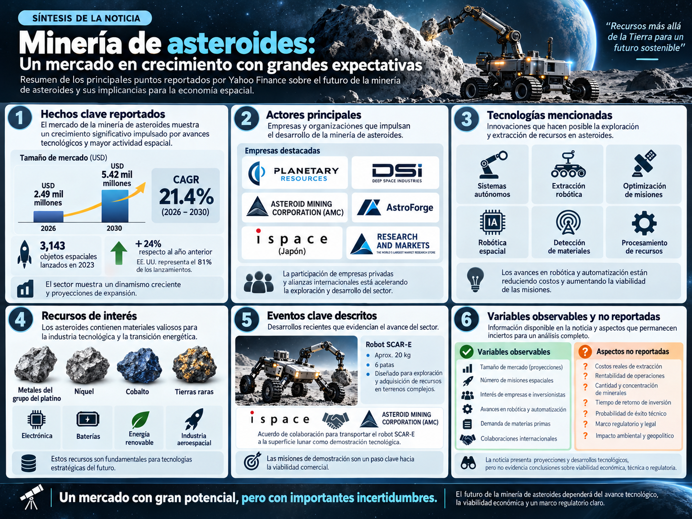
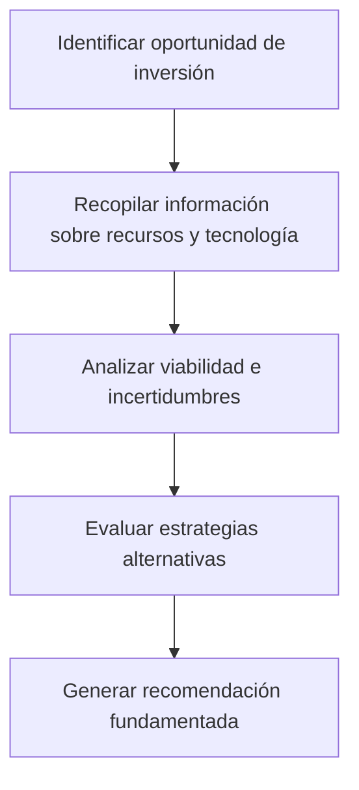

# Challenge 2: Pipeline de Machine Learning

## Minería de asteroides: evaluación experimental de estrategias de inversión

**Curso:** Machine Learning  
**Universidad:** Universidad Peruana Cayetano Heredia (UPCH)  
**Facultad:** Ciencias e Ingeniería  
**Docente:** Yannick Patrick Carrasco Merma  
**Modalidad:** Challenge individual

> **Alcance académico:** el espacio de estados y sus decisiones son un **modelo conceptual experimental**. Los seis escenarios de búsqueda y los 240 registros de costos son **sintéticos**. Ninguna ruta, predicción o cifra simulada prueba la viabilidad de la minería comercial de asteroides ni constituye asesoría de inversión.

## 1. Presentación del caso y problema

La minería de asteroides busca aprovechar recursos presentes en cuerpos celestes, entre ellos níquel, cobalto y metales del grupo del platino. La infografía del examen parcial presenta un sector con perspectivas de crecimiento y avances en robótica, automatización y exploración espacial. También identifica incertidumbres sobre los costos, la rentabilidad, el éxito técnico, los plazos y el marco regulatorio.

**Problema:** existe dificultad para seleccionar estrategias de exploración e inversión fundamentadas cuando la información tecnológica, económica y regulatoria es incompleta o incierta.

**Pregunta guía:** ¿Cómo identificar rutas válidas de evaluación de inversiones en minería de asteroides y cómo estimar una variable cuantitativa asociada a misiones *hipotéticas*, utilizando las técnicas de Inteligencia Artificial y Machine Learning estudiadas en clase?

### Objetivo general

Desarrollar dos pipelines experimentales que permitan **explorar estrategias de inversión** mediante un espacio de estados y **estimar costos simulados** mediante modelos de regresión, documentando sus supuestos, resultados y limitaciones.

### Objetivos específicos

- Representar el problema mediante estados, operadores, transiciones y restricciones.
- Aplicar y comparar BFS, DFS y búsqueda exhaustiva (BF) sobre escenarios de decisión.
- Preparar un dataset sintético reproducible para una tarea de regresión supervisada.
- Entrenar, comparar e interpretar regresión lineal y polinómica de grado 2.
- Presentar los resultados en GitHub y, posteriormente, en una web responsive e interactiva.

## 2. Contexto e investigación documental



*Figura 1. Infografía utilizada en el examen parcial. Fuente: material del caso proporcionado para la evaluación.*

La infografía aborda seis áreas: hechos clave del mercado, actores del sector, tecnologías recomendadas, recursos de interés, eventos relevantes y variables observables/no reportadas.

En particular, cita un mercado **estimado** en USD 2,49 mil millones para 2026 y una **proyección** de USD 5,42 mil millones para 2030, con un crecimiento anual compuesto (CAGR) del 21,4 %. Son **estimaciones comerciales de mercado**, no ingresos observados de extracción minera de asteroides ni costos de misiones. Véase la [fuente del informe de mercado](https://www.thebusinessresearchcompany.com/report/asteroid-mining-global-market-report).

Las misiones científicas y las demostraciones tecnológicas ofrecen referencias sobre exploración espacial y obtención de muestras, pero no validan por sí solas la viabilidad de explotar recursos a escala comercial.

## 3. Representación conceptual

El proceso de evaluación se simplifica en cinco etapas. Este esquema presenta el **flujo general del análisis**, distinto del espacio de estados con ramificaciones del siguiente apartado.



## 4. Espacio de estados

Se diseñó un grafo conceptual de **18 estados (S0–S17)** y **28 transiciones** sujetas a condiciones experimentales. La exploración comienza en **S0: Oportunidad identificada**.


*Figura 2. Espacio de estados completo utilizado en el Pipeline 1.*

### Estados terminales

| Estado | Decisión representada |
|---|---|
| **S15** | Ampliar investigación |
| **S16** | Inversión gradual **en investigación y desarrollo (I+D)** |
| **S17** | Postergar inversión |

### Operadores y restricciones

Los operadores permiten recopilar evidencia, comprobar recursos, evaluar factibilidad tecnológica, revisar condiciones económicas y regulatorias, plantear pruebas piloto y emitir recomendaciones según los resultados *supuestos*. Cada transición tiene una condición explícita de tipo **SI–ENTONCES**.

Entre las restricciones están: no avanzar sin evidencia suficiente; no considerar factibilidad técnica sin recursos prometedores; revisar economía y regulación antes de recomendar inversión; no inventar datos ausentes; y no confundir inversión gradual en I+D con minería comercial inmediata.

**Especificaciones y escenarios:** [espacio_estados_condiciones.json](./data/espacio_estados_condiciones.json) · [escenarios_asteroides.json](./data/escenarios_asteroides.json).

## 5. Pipeline 1: razonamiento, exploración, búsqueda y resultados

Se utiliza principalmente **razonamiento deductivo**: las condiciones de cada escenario, junto con reglas explícitas, determinan las transiciones habilitadas. Los algoritmos corresponden a las sesiones de búsqueda del curso.

| Algoritmo | Estrategia |
|---|---|
| **BFS** | Explora por niveles; en un grafo no ponderado encuentra una ruta con el menor número de transiciones. |
| **DFS** | Profundiza en una alternativa antes de retroceder. |
| **BF (Brute Force)** | Enumera exhaustivamente las rutas simples válidas hacia el objetivo, dentro del modelo finito. |

**Notebook:** [01_Pipeline_Razonamiento_Busqueda_Resultados.ipynb](./notebooks/01_Pipeline_Razonamiento_Busqueda_Resultados.ipynb)  
**Abrir en Colab:** [Pipeline 1](https://colab.research.google.com/github/pao25-ing/Machine_Learning/blob/main/Challenge_2/notebooks/01_Pipeline_Razonamiento_Busqueda_Resultados.ipynb)

### Comparación del escenario favorable

**Origen:** S0. **Objetivo buscado:** S16 (inversión gradual en I+D).

| Algoritmo | Evaluaciones registradas | Ruta al objetivo |
|---|---:|---|
| BFS | 9 | 7 transiciones |
| DFS | 10 | 9 transiciones |
| BF | 11 evaluaciones en rutas | 2 rutas completas enumeradas |

**Ruta encontrada por BFS:** `S0 → S1 → S3 → S4 → S6 → S8 → S10 → S16`.

**Ruta encontrada por DFS:** `S0 → S1 → S3 → S4 → S6 → S8 → S10 → S12 → S13 → S16`.

Las evaluaciones de BF pueden incluir estados repetidos entre rutas, por lo que su conteo **no es directamente comparable** con el número de estados evaluados por BFS y DFS. BFS encontró menos transiciones, **no un costo de inversión más bajo**.


Se evaluaron seis escenarios sintéticos: favorable, evidencia insuficiente, limitaciones tecnológicas, economía desfavorable, prueba piloto desfavorable y datos incompletos. En el último, el sistema conserva la evaluación pendiente sin inventar una decisión.

**Resultados CSV:** [comparacion_busqueda.csv](./results/comparacion_busqueda.csv) · [escenarios_busqueda.csv](./results/escenarios_busqueda.csv).

## 6. Pipeline 2: predicción y visualización

**Tipo de aprendizaje:** supervisado.  
**Tarea:** regresión de una variable numérica continua.  
**Pregunta:** ¿Cómo cambia el **costo hipotético** de una misión de exploración según su duración, masa del equipo, complejidad técnica y grado de autonomía?

### Dataset sintético

Se generaron **240 observaciones completamente sintéticas** mediante una fórmula educativa con términos lineales, cuadráticos y ruido aleatorio. Los valores **no** son registros de costos reales ni presupuestos de misiones.

| Variable | Función |
|---|---|
| `duracion_meses` | Entrada: duración hipotética |
| `masa_equipo_kg` | Entrada: masa hipotética del equipo |
| `complejidad_tecnica` | Entrada: nivel sintético del 1 al 5 |
| `autonomia_pct` | Entrada: autonomía hipotética (%) |
| `costo_simulado_musd` | **Objetivo:** millones de USD hipotéticos |

Se usaron **192 registros para entrenamiento (80 %)** y **48 para prueba (20 %)**, con una partición reproducible. La comparación incluye regresión lineal, regresión polinómica de grado 2 y un modelo constante de referencia.

**Dataset:** [escenarios_costos_SINTETICOS.csv](./data/escenarios_costos_SINTETICOS.csv)  
**Notebook:** [02_Pipeline_Prediccion_Visualizacion.ipynb](./notebooks/02_Pipeline_Prediccion_Visualizacion.ipynb)  
**Abrir en Colab:** [Pipeline 2](https://colab.research.google.com/github/pao25-ing/Machine_Learning/blob/main/Challenge_2/notebooks/02_Pipeline_Prediccion_Visualizacion.ipynb)

### Resultados de predicción

| Modelo | MAE ↓ | RMSE ↓ | R² ↑ |
|---|---:|---:|---:|
| Referencia (promedio) | 40,10 | 49,93 | -0,0032 |
| Regresión lineal | 7,06 | 8,64 | 0,9700 |
| **Regresión polinómica (grado 2)** | **6,72** | **8,33** | **0,9721** |

*MAE y RMSE en millones de USD **hipotéticos**, calculados sobre los 48 registros sintéticos de prueba.*

La regresión polinómica obtuvo una mejora **ligera** frente a la lineal. Esto es consistente con la función cuadrática utilizada para generar los costos; no garantiza mejor rendimiento con datos reales.


**Resultados CSV:** [comparacion_regresion.csv](./results/comparacion_regresion.csv) · [predicciones_prueba.csv](./results/predicciones_prueba.csv).

## 7. Discusión y conclusiones

El **Pipeline 1** representa múltiples rutas de análisis de inversiones y muestra diferencias entre estrategias de búsqueda. El **Pipeline 2** aprende patrones de un conjunto de datos sintéticos y compara modelos para estimar una variable continua.

Los dos pipelines **no realizan una decisión económica conjunta automática**: el costo simulado del segundo no determina por sí solo si el escenario del primero es económicamente favorable. Para hacerlo con validez real se necesitarían datos sobre ingresos, riesgos, financiamiento, regulación y criterios cuantitativos verificables.

En consecuencia, el proyecto **demuestra la aplicación académica de técnicas de razonamiento, búsqueda y regresión**, sin probar viabilidad técnica ni rentabilidad comercial de la minería de asteroides.

## 8. Web responsive

**En desarrollo.** Se incorporará una página web en la carpeta `web/`, adaptable a computadora, tablet y celular. Mostrará el contexto del caso, un grafo interactivo, exploración de algoritmos, comparación de resultados y gráficas de regresión. Las simulaciones conservarán advertencias visibles sobre su carácter experimental.

## 9. Estructura del repositorio

```text
Challenge_2/
├── README.md
├── notebooks/
│   ├── 01_Pipeline_Razonamiento_Busqueda_Resultados.ipynb
│   └── 02_Pipeline_Prediccion_Visualizacion.ipynb
├── data/
│   ├── espacio_estados_condiciones.json
│   ├── escenarios_asteroides.json
│   ├── escenarios_costos_SINTETICOS.csv
│   └── escenarios_costos_SINTETICOS.json
├── images/
│   ├── infografia_mineria_asteroides.png
│   ├── espacio_estados_asteroides.png
│   └── [gráficos de ambos pipelines]
├── results/
│   ├── comparacion_busqueda.csv
│   ├── escenarios_busqueda.csv
│   ├── comparacion_regresion.csv
│   └── predicciones_prueba.csv
└── web/                  # pendiente de implementación
```

## 10. Ejecución de los notebooks

Los dos notebooks se pueden abrir desde los enlaces de Colab anteriores y ejecutar mediante **Entorno de ejecución → Ejecutar todas**. El primero contiene los datos del grafo para una ejecución autónoma; el segundo puede regenerar el mismo dataset sintético si no encuentra el CSV. Para reproducir las métricas originales deben mantenerse los supuestos y semillas previstos.

**Tecnologías:** Python, Google Colab, `pandas`, `numpy`, `matplotlib`, `networkx` y `scikit-learn`. La web utilizará HTML, CSS, JavaScript y Chart.js.

## 11. Fuentes y material del curso

- Infografía de **minería de asteroides** y preguntas del examen parcial de Machine Learning (UPCH, 2026).
- Rúbrica del **Challenge: Pipeline de Machine Learning**, UPCH (2026).
- UPCH, sesiones 1–4: razonamiento en IA, representación, DFS/BFS, búsqueda exhaustiva, Hill Climbing y A*.
- UPCH, sesiones 5–7: tipos de aprendizaje, tareas de Machine Learning, regresión lineal, no lineal y logística.
- [NASA — Is NASA Mining Asteroids?](https://www.nasa.gov/general/is-nasa-mining-asteroids-we-asked-a-nasa-scientist-episode-41/)
- [NASA — Misión Psyche](https://science.nasa.gov/mission/psyche/)
- [NASA — OSIRIS-REx](https://science.nasa.gov/mission/osiris-rex/)
- [NASA/JPL — Small-Body Database](https://ssd.jpl.nasa.gov/tools/sbdb_query.html)
- [The Business Research Company — Asteroid Mining Market Report](https://www.thebusinessresearchcompany.com/report/asteroid-mining-global-market-report)
- [UNOOSA — Outer Space Treaty](https://www.unoosa.org/oosa/en/ourwork/spacelaw/treaties/outerspacetreaty.html)

---

*Proyecto académico de Machine Learning — Universidad Peruana Cayetano Heredia, 2026.*
